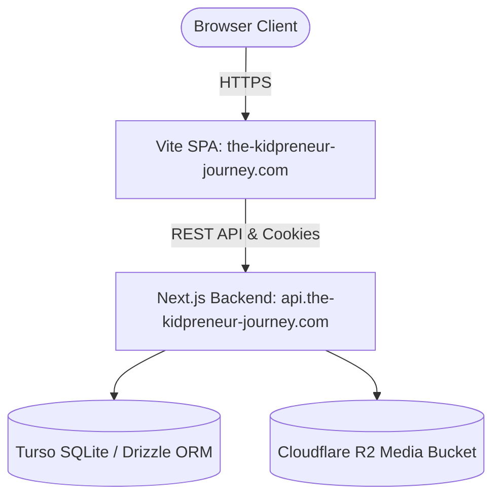

# Vite Showcase Frontend — Code Documentation

> **Kidpreneur Showcase & Public Portfolio**  
> Built with **Vite 8.2**, **React 19.2**, **TypeScript 6 (Strict)**, and **Tailwind CSS v4**.  
> Production deployment: Hosted on **Cloudflare Workers** (`kidpreneur-vite`) serving [`https://the-kidpreneur-journey.com`](https://the-kidpreneur-journey.com).

---

## 1. Architectural Overview

The `VITE` application serves as the **public-facing marketing, portfolio, and workshop registration portal** for The Kidpreneur Journey. It communicates with the `next-app` backend via REST API (`https://api.the-kidpreneur-journey.com/api` or `/api` via proxy) with full credential support (`credentials: 'include'`).



### Key Architectural Traits
- **Client-Side Routing**: Handled using `react-router-dom` (React Router v7).
- **Styling Architecture**: Tailwind CSS v4 using the modern `@tailwindcss/vite` plugin with custom CSS custom properties defined in `src/index.css`.
- **Stateless Showcase + Hybrid Auth**: Consumes public portfolio items, blog entries, and activity showcases while maintaining optional session tracking via `AuthContext` calling `/api/auth/me`.
- **Strict Brand Design System**:
  - Ink / Navy: `#1C2455` (Primary text, borders, headers)
  - Sun / Brand Yellow: `#FFC93C` (Primary CTA buttons, badges)
  - Brand Blue: `#2F7DE1` (Links, accents)
  - Soft Ice Blue: `#EEF5FF` (Pills, section dividers, backgrounds)
  - Offwhite Canvas: `#FFFDF7` (Clean page backgrounds)

---

## 2. Directory Structure & File Map

```
VITE/
├── public/                     # Static assets (favicons, logos, instagram photos)
├── src/
│   ├── assets/                 # Embedded SVG/PNG assets (hero, sara.webp, icons)
│   ├── components/
│   │   ├── auth/               # Login & Registration modal dialogues
│   │   ├── layout/             # Navigation bars & Global footer
│   │   ├── portfolio/          # Workshop, activity, and Instagram cards + Lightbox
│   │   ├── sections/           # Modular homepage landing sections
│   │   └── DataViewer.tsx      # Diagnostic JSON / API viewer
│   ├── context/
│   │   └── AuthContext.tsx     # Global authentication provider & state hook
│   ├── data/
│   │   └── blogPosts.ts        # Static fallback & curated blog articles
│   ├── hooks/
│   │   └── useSessions.ts      # Custom session & cohort query hooks
│   ├── pages/
│   │   ├── PortfolioPage.tsx   # Filterable workshop, activity & media archive
│   │   └── WorkshopDetailPage.tsx # Rich single workshop view with gallery & CTA
│   ├── services/
│   │   ├── api.ts              # Core API fetch client configuration
│   │   └── portfolioApi.ts     # Data service for portfolio & Instagram endpoints
│   ├── App.css                 # Global application layout styles
│   ├── App.tsx                 # Root router & layout container
│   ├── index.css               # Tailwind CSS v4 design tokens & button styles
│   └── main.tsx                # React 19 DOM bootstrap & entrypoint
├── index.html                  # HTML5 SPA shell
├── package.json                # Project dependencies & build scripts
├── tsconfig.json               # TypeScript configuration root
├── tsconfig.app.json           # Client app compiler options
├── tsconfig.node.json          # Vite node tooling compiler options
└── vite.config.ts              # Vite 8 bundler configuration
```

---

## 3. Detailed Component & File Breakdown

### A. Root & Configuration Files

#### `vite.config.ts`
- **Purpose**: Configures Vite 8 bundling, plugins, and development server proxy.
- **Key Features**:
  - Configures `@vitejs/plugin-react` for React 19 JSX transformation.
  - Integrates `@tailwindcss/vite` for zero-configuration Tailwind CSS v4 processing.
  - Configures development proxy redirecting `/api` requests to local `http://localhost:3000`.

#### `src/main.tsx`
- **Purpose**: Application root mounting point.
- **Behavior**: Initializes `ReactDOM.createRoot` on `#root` inside `React.StrictMode` and wraps `App.tsx` within `<AuthProvider>`.

#### `src/App.tsx`
- **Purpose**: Client-side router definition and persistent global chrome.
- **Routes Managed**:
  - `/`: Main interactive homepage (`Hero`, `MissionVision`, `SkillsWeTeach`, `Pathways`, `Activities`, `FeaturedPortfolio`, `About`, `BlogSection`, `Contact`).
  - `/portfolio`: Complete portfolio directory with category tabs and search.
  - `/portfolio/:slug`: Detailed view for a specific workshop or event.
- **Layout**: Renders `MegaMenuNavbar` at the top and `Footer` at the bottom across all views.

#### `src/index.css`
- **Purpose**: Tailwind CSS v4 entry point and custom design system definitions.
- **Contains**:
  - Color variables (`--sun`, `--sun-ink`, `--ink`, `--bg`, `--color-kidpreneur-yellow`, etc.).
  - Font families (`Fredoka` for display titles, `Nunito` for clean body typography).
  - Button utilities:
    - `.btn-sun`: Chunky pill button with brand yellow background, navy border, 3px solid drop shadow, and smooth translate hover effect.
    - `.btn-alt`: Secondary outline button with transparent background and navy text.

---

### B. Layout Components (`src/components/layout/`)

#### `MegaMenuNavbar.tsx`
- **Purpose**: Primary sticky navigation bar.
- **Key Features**:
  - Sticky glassmorphic header with `#fffdf7` background and 1px border.
  - Single brand logo with byline (`/kidpreneur-logo-with-byline.png`).
  - Smooth anchor link navigation to `#home`, `#pathways`, `#about`, `#contact`.
  - Floating pathways dropdown card on hover with quick links to Workshops, Courses, and Collaborations.
  - Mobile responsive drawer with accessible hamburger toggle.

#### `Navbar.tsx`
- **Purpose**: Alternative minimal navigation header used for standalone subpages.

#### `Footer.tsx`
- **Purpose**: Global site footer.
- **Content**:
  - Kidpreneur brand summary and mission statement.
  - Quick in-page anchor links (`About`, `Pathways`, `Contact`). Note: "Portfolio" link is intentionally hidden per user design directives.
  - Social connections (Dr. Sarah Sidani Instagram `@dr.sarahsidani`, Kidpreneur Instagram `@kidpreneur.journey`, and WhatsApp `+961 79 332 143`).
  - Copyright and legal credits.

---

### C. Homepage Landing Sections (`src/components/sections/`)

#### `Hero.tsx`
- **Purpose**: Main hero conversion section.
- **Highlights**:
  - Subheader pill: `"Where Kids Turn Ideas into Actions"`.
  - Display headline: *"Where young minds learn to think, create, and lead."*
  - CTA Button Row:
    - **Explore Lab**: Styled with `.btn-sun`, features an interactive **`COMING SOON`** navy pill badge while the lab portal is under enhancement.
    - **Checkout Pathways**: Smoothly scrolls to `#pathways`.
  - Band separator: *"Every child has ideas worth listening to."*

#### `About.tsx`
- **Purpose**: "Meet the Founder" section spotlighting Dr. Sarah Sidani.
- **Key Elements**:
  - High-resolution founder portrait (`assets/sara.webp`) with brand border styling.
  - Concise bio highlighting her PhD in Entrepreneurship, role as Entrepreneurship Educator & Expert, and experiential youth empowerment philosophy.
  - Direct CTA button linking to Dr. Sarah's Instagram (`@dr.sarahsidani`).

#### `MissionVision.tsx`
- **Purpose**: Highlights the core educational mission, experiential methodology, and future vision of the platform.

#### `SkillsWeTeach.tsx`
- **Purpose**: Interactive presentation of the core competency framework: Problem Solving, Creative Ideation, Unit Economics, Digital Literacy, and Public Pitching.

#### `Pathways.tsx`
- **Purpose**: Three core learning channels:
  1. **Workshops**: In-person cohort intensives and interactive weekend bootcamps.
  2. **Courses**: Online structured entrepreneurship curricula with bi-weekly group coaching.
  3. **Collaborations**: School programs, institutional partnerships, and NGO workshops.

#### `Activities.tsx`
- **Purpose**: Interactive preview of hands-on tools used by students (Idea Scorecard, Strengths Selector, Financial Calculator).

#### `FeaturedPortfolio.tsx`
- **Purpose**: Dynamic showcase grid of recent workshop highlights and Instagram classroom moments fetched live via `portfolioApi.ts`.

#### `BlogSection.tsx`
- **Purpose**: Educational editorial hub featuring articles for parents and educators on raising enterprising, creative children.

#### `Contact.tsx`
- **Purpose**: Inquiries and outreach section.
- **Features**:
  - Direct WhatsApp messaging button (`+961 79 332 143`).
  - Instagram connection cards (`@dr.sarahsidani` and `@kidpreneur.journey`).
  - Interactive message form submitting directly to `next-app`'s `/api/contact` endpoint.

---

### D. Portfolio Components & Pages

#### `src/components/portfolio/WorkshopCard.tsx`
- **Purpose**: Card component for workshop events. Displays cover photo, date, location tag, summary, and action link to the workshop detail page.

#### `src/components/portfolio/InstagramHybridCard.tsx`
- **Purpose**: Visual card designed for Instagram reel/post showcases. Features an Instagram glyph, video thumbnail, caption excerpt, and direct external link to the Instagram post.

#### `src/components/portfolio/LightboxModal.tsx`
- **Purpose**: Fullscreen accessible photo viewer allowing users to zoom and click through workshop gallery photos.

#### `src/pages/PortfolioPage.tsx`
- **Purpose**: Filterable archive page (`/portfolio`) with live category tabs (All, Workshops, Activities, Instagram Posts).

#### `src/pages/WorkshopDetailPage.tsx`
- **Purpose**: Dedicated slug page (`/portfolio/:slug`) rendering full workshop description, multi-photo gallery grid with lightbox modal, and direct registration CTA.

---

### E. Services & State Management

#### `src/services/portfolioApi.ts`
- **Purpose**: Typed fetch client querying `next-app`'s `/api/portfolio` endpoints:
  - `fetchPortfolioItems(params)`: Retrieves filtered published items with auto-expired date parsing.
  - `fetchPortfolioItemBySlug(slug)`: Retrieves detailed workshop metadata.
  - `fetchPortfolioActivities()`: Retrieves active curriculum activities.

#### `src/services/api.ts`
- **Purpose**: Centralized Axios/fetch abstraction providing the configured base URL (`VITE_API_BASE_URL` or fallback).

#### `src/context/AuthContext.tsx`
- **Purpose**: React context providing student authentication status (`user`, `loading`, `refreshUser`, `logout`) via cookie forwarding to `next-app`'s `/api/auth/me`.

---

## 4. Local Development & Deployment

### Run Locally:
```powershell
cd VITE
npm run dev        # Dev server on http://localhost:5173
```

### Production Build:
```powershell
cd VITE
npm run build      # Executes 'tsc -b && vite build' -> outputs to dist/
```

### Deploy to Cloudflare:
```powershell
# Deploys dist/ assets directly to Cloudflare Worker 'kidpreneur-vite'
npx --prefix next-app wrangler deploy VITE/dist --name kidpreneur-vite --compatibility-date 2024-09-23
```

